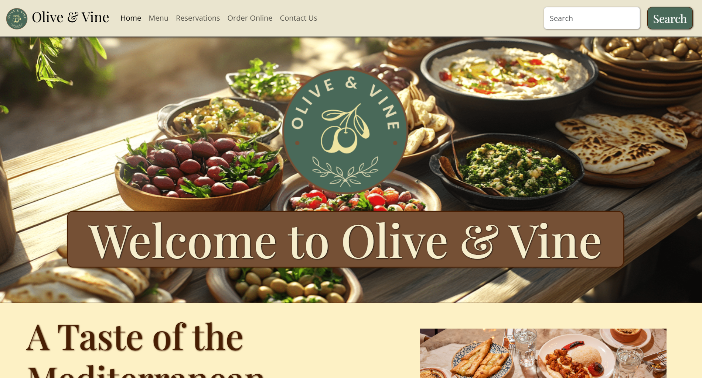
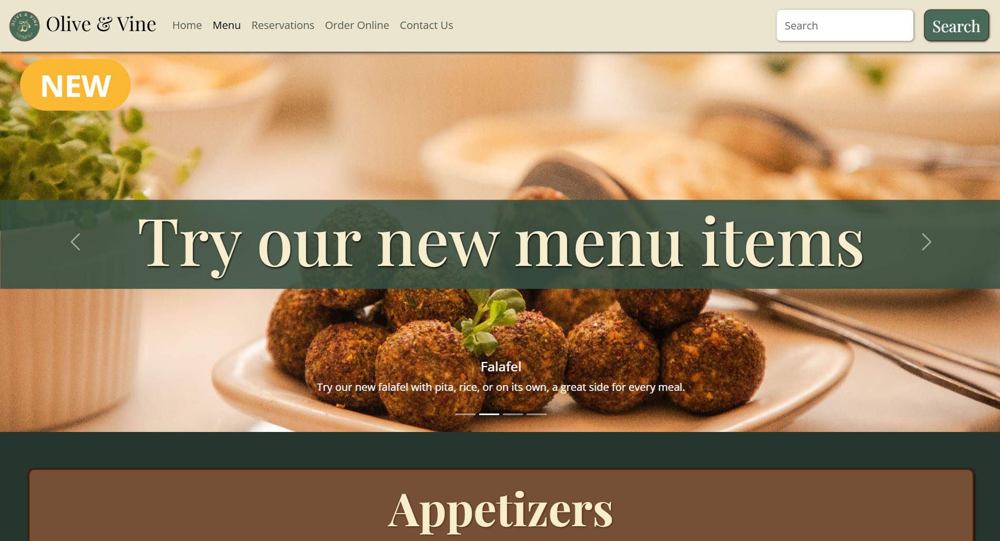
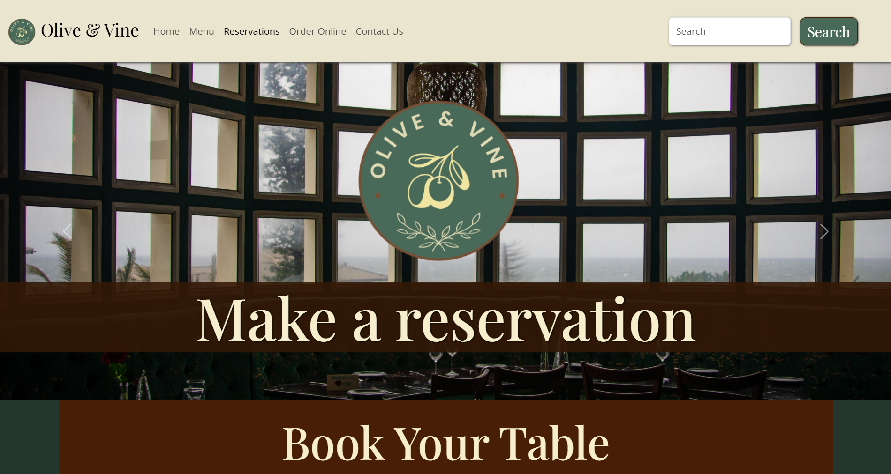
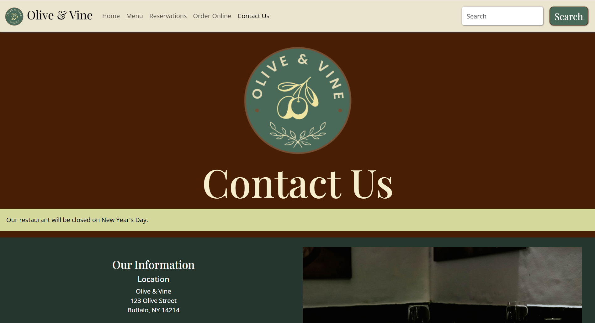

# Olive and Vine
Responsive restaurant website for “Olive &amp; Vine,” a modern Mediterranean concept built with HTML, CSS, and Bootstrap.

View the website here: [Olive & Vine](https://takiatah.github.io/olive-and-vine-website/)

## Tools
* HTML
* Bootstrap
* CSS
* JavaScript

## Preview

## Future Improvements

- Add JavaScript functionality for image carousel controls
- Add product filtering and search features
- Create an onsite order system

## Image Credits

Images used in this project were sourced from:
- Pexels (https://www.pexels.com/)
- Unsplash (https://unsplash.com/)

All images are used for demonstration purposes. Credit belongs to the original photographers and creators.

## Author

Created by Takia Tahmid